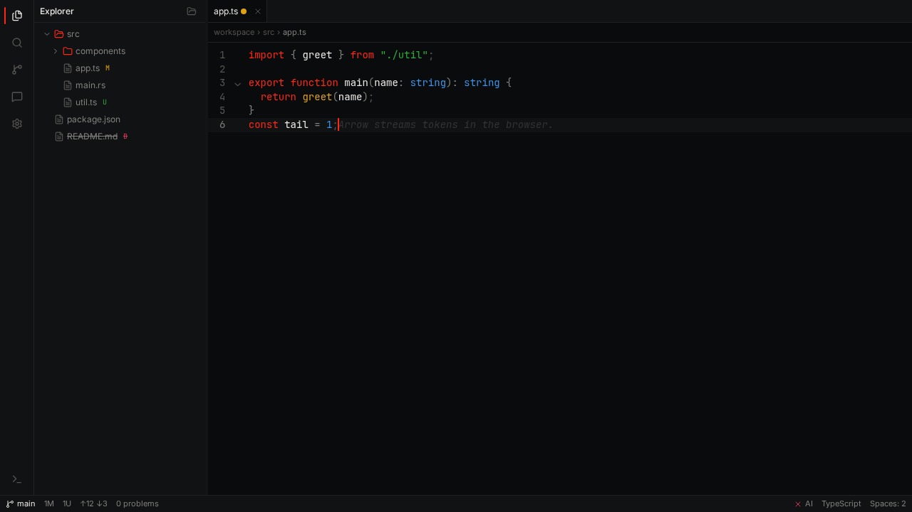
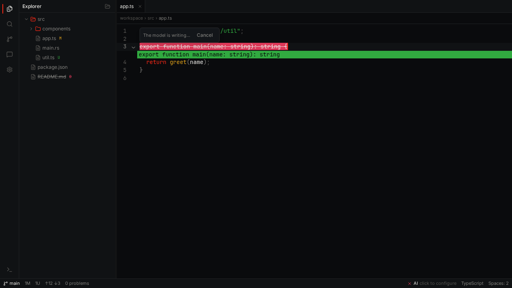
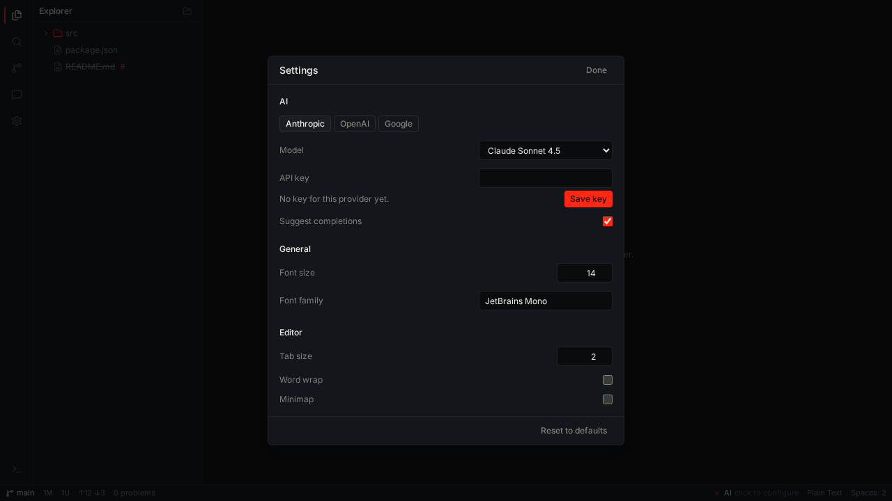
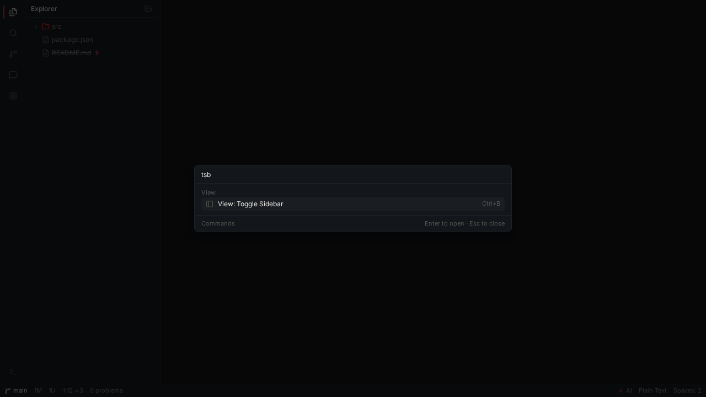
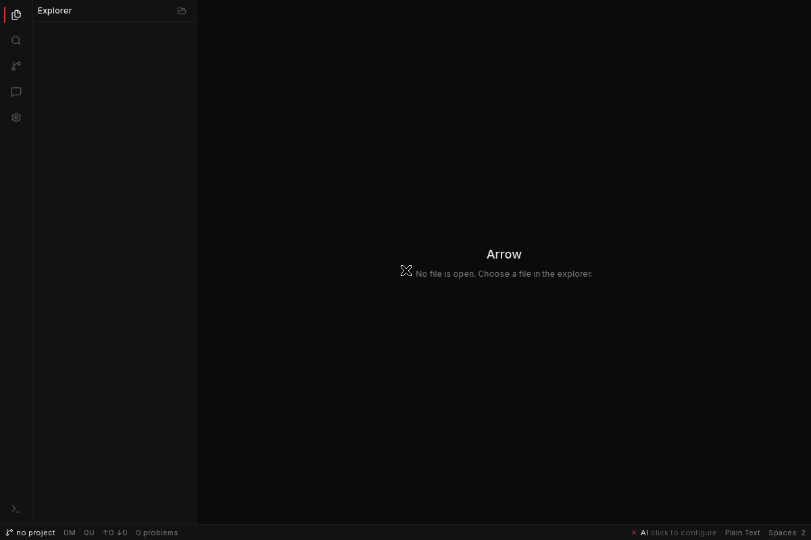

# Arrow

Arrow is a desktop code editor built with Tauri v2, React 19 and Vite, with AI completions and an
inline edit that run in the Rust shell. It is for developers who want to know where their code
runs and where their API key lives.

[](https://github.com/paramcodes/arrow/actions/workflows/ci.yml)

A file open in the editor, with the completion of the AI feature as ghost text after the caret. The
tree carries the `M`, `U` and `D` badges of git, and the status bar shows the state of the AI
feature on the right.



A selection in the editor, with the answer of the model arriving as an inline diff. The lines the
model would remove are struck through, and the lines it would add sit under them.



The settings of the AI feature, with the provider, the model and the key.



The command palette finds a command of the shell from a few letters.



A fresh window of Arrow, before a file is open.



## What it does

- A file tree that follows the disk. The Rust watcher sends `fs:changed`, `fs:created` and
  `fs:deleted`, and the tree updates without a refresh.
- A CodeMirror 6 editor with tabs, breadcrumbs and a dirty marker. `Ctrl+S` writes the file back.
- Ghost text for the AI feature. The suggestion appears after the caret, `Tab` takes it and
  `Escape` throws it away.
- An inline edit on the selection. `Cmd+K` (`Ctrl+K` on Linux and Windows) opens a bar over the
  selection, the answer arrives as an inline diff, `Cmd+Enter` takes it and `Escape` leaves the
  code as it was.
- The model in the settings. The provider is `anthropic`, `openai` or `google`, and the list of
  models follows the provider.
- The first run. With no key in the keychain of the operating system, the status bar shows `AI
  click to configure`, and clicking it opens the settings.
- A terminal on a real PTY. Every tab owns one shell, and the output comes back in chunks.
- Git in the status bar and in the tree. The branch, the counts of the diff, and a badge on every
  changed file.
- A command palette on `Ctrl+Shift+P`, a project search, and a settings dialog whose values persist.

## Download

Every release publishes three Linux bundles for `x86_64`, built on Ubuntu by
[`.github/workflows/release.yml`](.github/workflows/release.yml). Take the file that matches your
system from the [releases page](https://github.com/paramcodes/arrow/releases).

| File                             | What it is          | How to run or install it                                       |
| -------------------------------- | ------------------- | -------------------------------------------------------------- |
| `Arrow_<version>_amd64.AppImage` | A single executable | `chmod +x Arrow_<version>_amd64.AppImage` then run the file    |
| `Arrow_<version>_amd64.deb`      | A Debian package    | `sudo apt install ./Arrow_<version>_amd64.deb`                 |
| `Arrow-<version>-1.x86_64.rpm`   | An RPM package      | `sudo dnf install ./Arrow-<version>-1.x86_64.rpm`              |

The `v0.5.0` release publishes `Arrow_0.5.0_amd64.AppImage`, `Arrow_0.5.0_amd64.deb` and
`Arrow-0.5.0-1.x86_64.rpm`.

The size and the SHA-256 of each file are written into the body of the release that carries it, in
the same table as the download links. Every release also carries `SHA256SUMS.txt`, so a download is
checked with:

```bash
sha256sum -c SHA256SUMS.txt
```

## What it costs, measured

<!-- perf-table:begin -->
| Editor | Idle memory, warm launch, process tree (MiB) | Cold start to first paint (ms) | Warm start to first paint (ms) | Install on disk (MiB) |
| --- | --- | --- | --- | --- |
| Arrow 0.5.0 | 337.8 | 6682 | 4491 | 252.1 |
| VS Code 1.143.0 | 1789.2 | 12423 | 6970 | 983.3 |
| Cursor 3.26.16 | 2335.2 | 15240 | 10812 | 1035.1 |
<!-- perf-table:end -->

The table is a measurement, not a feature comparison. `scripts/perf-compare.mjs` measured all three
editors on one machine on 22 October 2026, and the raw numbers sit in
[`docs/perf/results.json`](docs/perf/results.json). The machine is an Intel Core i3-4005U with four
threads and 7.6 GiB of RAM, running Omarchy on kernel 7.2.8, with every window on a private Xvfb
display at 1280x800.

Each editor ran from the vendor's unpacked Linux artifact on that display, started in its own
profile directory. A cold start is the first launch against an empty profile, and a warm start is
the second launch against the same one. The page cache was not flushed, because that needs root.
A start ends at the first capture of the window that proved paint. Idle memory is the median of
three samples of the resident set of the whole process tree, taken 25 seconds after the window
painted. Install size is the apparent size of the unpacked tree the editor runs from. The full
method, the artifacts and their URLs are in [`docs/perf/method.md`](docs/perf/method.md).

No folder is open in any editor, because the Arrow shell does not read a folder from its command
line. Every editor therefore ran with an empty window, under the same method, and these are the
smallest idle numbers each can show. Arrow has no extensions, no language server, no multi-cursor
and no remote development, and the numbers say nothing about which editor is better. The AI
features are outside the measurement, deliberately: Arrow keeps the provider key in the OS
keychain and never in the webview, so no run here touched a provider.

## Requirements

- Node.js 22 or newer. `package.json` asks for 22 or newer, and the workflow of CI installs 22.
- pnpm 12.9.1, the version `package.json` names in `packageManager`.
- A Rust toolchain on the stable channel, with the `clippy` and `rustfmt` components. CI installs
  it with `dtolnay/rust-toolchain@stable`.
- The Linux packages that the Tauri v2 shell needs. The list below is the one the workflow of CI
  installs, and it is the list to install:

  ```bash
  sudo apt-get update
  sudo apt-get install -y \
    libwebkit2gtk-4.1-dev \
    librsvg2-dev \
    patchelf \
    libxdo-dev \
    libssl-dev \
    libgtk-3-dev \
    libayatana-appindicator3-dev \
    build-essential \
    curl \
    wget \
    file
  ```

## Run it

```bash
git clone https://github.com/paramcodes/arrow.git
cd arrow
pnpm install --frozen-lockfile
pnpm dev
```

`pnpm dev` starts the Tauri shell. The shell starts the Vite dev server itself, so there is no
second terminal to open.

To work on the frontend in a browser instead, run it on its own. The web build has no Tauri host,
so every call to the shell answers from a stub:

```bash
pnpm --filter @arrow/desktop dev:web
```

The shell of Rust builds on its own with:

```bash
cargo build --manifest-path apps/desktop/src-tauri/Cargo.toml
```

## The gates

Five commands check the repository. CI runs all of them on every pull request.

| Command              | What it proves                                                                                                                                                                           |
| -------------------- | ---------------------------------------------------------------------------------------------------------------------------------------------------------------------------------------- |
| `pnpm verify`        | The format check, the lint, the typecheck, the unit tests and the build all pass.                                                                                                        |
| `pnpm test:e2e`      | The app boots in a plain browser with no Tauri host, and the editor, the tree, the terminal, the palette and the AI feature work when Playwright drives them.                            |
| `pnpm harness`       | The repository holds every criterion of `harness.config.json`. A criterion runs a real check against the tree, so a rule that kept its words while losing its behaviour fails the score. |
| `pnpm prove`         | Every guardrail catches the mistake it was made for. The prover writes the bad code on purpose and fails when a guardrail misses it.                                                     |
| `pnpm prove-harness` | The harness can fail. The script copies the harness into a scratch tree, breaks the copy seven ways, and fails when the scorer passes on any of them.                                    |

A test runner checks that the code does what it should. The harness scores a set of criteria
instead, and each criterion runs a check against the repository rather than against a function. The
scorer holds the exact list of criteria, so a criterion that is deleted, renamed or duplicated
fails the score. `pnpm prove-harness` answers the remaining question. It breaks a copy of the
harness seven ways and shows that the scorer fails on every one of them.

## How the code is laid out

| Path                     | What it owns                                                                                                                                                 |
| ------------------------ | ------------------------------------------------------------------------------------------------------------------------------------------------------------ |
| `apps/desktop/src-tauri` | The Rust shell. The file system, the terminal, git, the watcher and the AI client. It holds the key of the provider in the keychain of the operating system. |
| `apps/desktop/src`       | The React tree of the desktop shell. It owns the screen and every call to the shell.                                                                         |
| `packages/editor-core`   | The editor engine, on CodeMirror 6. It owns the documents.                                                                                                   |
| `packages/ui`            | The shared UI primitives. They read theme tokens and never Tauri.                                                                                            |
| `packages/theme`         | The dark-first design tokens every layer reads.                                                                                                              |
| `packages/types`         | The shared type contracts.                                                                                                                                   |
| `scripts`                | The gates: the scorer, the prover, the self proof, the theme check and the branch guard.                                                                     |

Four boundaries hold the tree together, and each one names the path that fails when it breaks.

- The packages under `packages/` never import the Tauri API and never import the desktop app.
  `eslint.arch.mjs` fails the build when one does.
- The frontend boots in a plain browser with no Tauri host.
  `apps/desktop/e2e/smoke.spec.ts` proves it with Playwright.
- Every color comes from a token in `packages/theme`. `scripts/check-theme-discipline.mjs` scans
  the source for a literal.
- Workspace facts live in Zustand, per item facts live in Jotai and async workflows live in
  XState. No store imports another tier.

## The AI feature

- The key of a provider lives in the keychain of the operating system and in Rust. The bridge
  never hands it back. The command `get_api_key` answers with a boolean, and the lint rule
  `local/no-secret-in-webview` refuses a key inside the webview.
- The providers are `anthropic`, `openai` and `google`. The registry in
  `apps/desktop/src-tauri/src/ai/models.rs` holds the models of the three.
- The Rust client owns the HTTP call and the stream, and normalizes each provider into one event
  shape. The React tree never reads a provider protocol.
- The shell holds the commands `complete`, `inline_edit` and `cancel_request`. The inline edit and
  the ghost text reach the provider through the same client, and one cancel path ends both.
- The web build answers from a stub. With no Tauri host, the bridge in `apps/desktop/src/lib/ai.ts`
  replays a canned token stream, so Playwright can drive the ghost text in a plain browser.
- `ARROW_AI_BASE_URL` points the client at a local stand-in for a provider. It is for a stand-in
  on this machine, and only a loopback host (`127.0.0.1`, `::1`, `localhost`) is honored; any other
  value is ignored and the request goes to the provider.

## Documentation

- [The MVP plan](docs/plan/mvp-plan.md) holds the eleven sessions of the plan and the exit gate of
  each.
- [The architecture decision records](docs/adr/README.md) hold eight decisions, each with the
  options it replaced.
- [The mistake log](docs/mistake-log.md) holds every mistake the repository has made and the
  guardrail that now catches it.
- [The ratchet](docs/ratchet.md) holds the procedure that turns a mistake into a permanent check.
- [The contract of the repository](AGENTS.md) holds the rules and the path that enforces each one.
- [The design system](DESIGN.md) holds the tokens of the product.
- [The discovery round](docs/plan/discovery.md) holds the research behind the decisions.
