# 🏹 Arrow — MVP Implementation Plan

> [!IMPORTANT]
> **Decisions locked:**
> Tauri v2 · CodeMirror 6 · React 19 · shadcn/ui · Motion · Tailwind v4 · Zustand + Jotai + XState · Oxlint + ESLint · Biome · pnpm · Turborepo · Vitest + Playwright · Dark-first · Backend proxy for AI · MVP = Phase 4 (inline AI) · Desktop only · Name: **Arrow**

---

## Commit & Branch Strategy

```
main (protected, always green)
 ├── feat/p1s1/scaffold          → PR #1
 ├── feat/p1s2/design-tokens     → PR #2
 ├── feat/p1s3/shell-layout      → PR #3
 ├── feat/p2s1/codemirror        → PR #4
 ├── ...                         → ...
 └── feat/p4s3/model-config      → PR #11
```

| Rule | Detail |
|------|--------|
| **Commit format** | Conventional: `feat(scope): message`, `fix(scope):`, `chore(scope):` |
| **Commit frequency** | Every logical unit (component, config, integration) — ~5-15 per session |
| **Branch per session** | `feat/p{phase}s{session}/{slug}` |
| **PR per session** | Session ends → PR to `main`. Harness + CI must pass. |
| **Tag per phase** | `v0.1.0` (P1), `v0.2.0` (P2), `v0.3.0` (P3), `v0.4.0-mvp` (P4) |
| **Default branch guard** | `scripts/guard-branch.sh` prevents direct commits to `main` |

---

## Phase 1: Foundation Shell 🏗️
**Goal**: Tauri app boots, shows themed layout with resizable panels.
**Tag**: `v0.1.0`

---

### Session 1 — Scaffold & Tooling
**Branch**: `feat/p1s1/scaffold`
**Objective**: Monorepo with Tauri + React + Vite boots to a blank window. All tooling configured and harness installed.

#### Tasks

1. **Initialize monorepo**
   ```
   pnpm init
   pnpm-workspace.yaml  →  packages: ["apps/*", "packages/*"]
   turbo.json            →  pipeline: dev, build, lint, typecheck, verify, harness, prove
   ```

2. **Create Tauri v2 app**
   ```
   apps/desktop/
   ├── src-tauri/
   │   ├── Cargo.toml
   │   ├── tauri.conf.json
   │   ├── capabilities/       ← Tauri v2 security capabilities
   │   └── src/main.rs         ← minimal Tauri entry
   └── src/
       ├── main.tsx            ← React root
       ├── App.tsx             ← placeholder
       └── index.html
   ```

3. **Configure Vite**
   ```
   apps/desktop/vite.config.ts  →  @vitejs/plugin-react, path aliases
   ```

4. **TypeScript strict mode**
   ```
   tsconfig.json (root)         →  references to packages
   apps/desktop/tsconfig.json   →  strict: true, paths: @arrow/*
   packages/ui/tsconfig.json
   packages/editor-core/tsconfig.json
   packages/theme/tsconfig.json
   packages/types/tsconfig.json
   ```

5. **Install & configure Oxlint + ESLint hybrid**
   ```
   oxlint.json                  →  standard rules (react, typescript, unicorn)
   eslint.config.mjs            →  type-aware rules only, no-inline-config, ban-ts-comment
   eslint.arch.mjs              →  layer boundaries from harness
   eslint-rules/index.mjs       →  escape hatch rules
   ```

6. **Configure Biome formatter**
   ```
   biome.json                   →  indentStyle: space, indentWidth: 2, lineWidth: 100
   ```

7. **Install agent-ready harness**
   ```bash
   bash ~/.agents/skills/agent-ready-harness/scripts/install-harness.sh .
   ```
   Then adapt:
   ```
   harness.config.json          →  Arrow-specific layers, criteria
   AGENTS.md                    →  Arrow rules with enforcement paths
   CLAUDE.md                    →  Points to AGENTS.md
   lefthook.yml                 →  pre-commit: biome format, oxlint, tsc
   .github/workflows/ci.yml    →  verify + harness + prove
   docs/ratchet.md
   docs/mistake-log.md
   ```

8. **Package.json scripts**
   ```json
   {
     "dev": "turbo dev",
     "build": "turbo build",
     "lint": "oxlint . && eslint .",
     "format": "biome format .",
     "format:check": "biome format --check .",
     "typecheck": "tsc -b",
     "test": "vitest run",
     "verify": "pnpm format:check && pnpm lint && pnpm typecheck && pnpm test && pnpm build",
     "harness": "node scripts/harness-score.mjs",
     "prove": "node scripts/prove-guardrails.mjs"
   }
   ```

#### Exit Criteria
- [ ] `pnpm dev` opens a Tauri window with "Arrow" in title bar
- [ ] `pnpm verify` passes (format, lint, typecheck, build)
- [ ] `pnpm harness` scores 10/10
- [ ] `pnpm prove` reports 0 missed cases
- [ ] Monorepo structure: `apps/desktop`, `packages/{ui,editor-core,theme,types}`

#### Commits (~8)
```
chore: init pnpm monorepo with turborepo
feat(desktop): scaffold Tauri v2 + React + Vite app
chore: configure TypeScript strict across workspaces
chore: configure Oxlint + ESLint hybrid linting
chore: configure Biome formatter
chore(harness): install and adapt agent-ready harness
chore: add AGENTS.md and CLAUDE.md with enforcement paths
chore: add lefthook pre-commit and CI workflow
```

---

### Session 2 — Design Tokens & Theme
**Branch**: `feat/p1s2/design-tokens`
**Objective**: Cursor dark theme implemented as Tailwind CSS tokens. All design primitives ready.

#### Tasks

1. **Pull Cursor design system**
   ```bash
   npx getdesign@latest add cursor
   ```
   → `DESIGN.md` lands in root

2. **Create dark variant tokens** in `packages/theme/`
   ```
   packages/theme/
   ├── src/
   │   ├── tokens.css           ← CSS custom properties (dark-first)
   │   ├── colors.ts            ← exported color constants for JS usage
   │   └── index.ts             ← barrel export
   ├── tailwind.preset.ts       ← Tailwind v4 preset extending @theme
   ├── package.json
   └── tsconfig.json
   ```

   Dark tokens (derived from Cursor aesthetic):
   ```css
   :root {
     /* Surfaces */
     --canvas:           oklch(0.15 0.005 250);    /* deep charcoal */
     --canvas-soft:      oklch(0.18 0.005 250);    /* panel backgrounds */
     --canvas-strong:    oklch(0.12 0.005 250);    /* sidebar */
     --surface:          oklch(0.20 0.008 250);    /* cards, dropdowns */
     --surface-hover:    oklch(0.23 0.008 250);
     --border:           oklch(0.25 0.005 250);    /* hairline borders */
     --border-strong:    oklch(0.30 0.005 250);

     /* Text */
     --ink:              oklch(0.93 0.005 90);     /* primary text */
     --ink-secondary:    oklch(0.60 0.005 90);     /* muted text */
     --ink-tertiary:     oklch(0.45 0.005 90);     /* disabled */

     /* Accent */
     --accent:           oklch(0.65 0.25 30);      /* Arrow orange (#f54e00 equiv) */
     --accent-hover:     oklch(0.60 0.25 30);
     --accent-soft:      oklch(0.25 0.08 30);      /* subtle accent bg */

     /* Semantic */
     --success:          oklch(0.65 0.18 145);
     --warning:          oklch(0.75 0.15 80);
     --error:            oklch(0.60 0.20 15);
     --info:             oklch(0.65 0.15 250);

     /* Typography */
     --font-sans:        'Inter', system-ui, sans-serif;
     --font-mono:        'JetBrains Mono', 'Berkeley Mono', monospace;
     --font-display:     'Inter', system-ui, sans-serif;

     /* Spacing scale */
     --radius-sm: 4px;
     --radius-md: 6px;
     --radius-lg: 8px;
   }
   ```

3. **Configure Tailwind v4 with preset**
   ```
   apps/desktop/app.css         ← @import "tailwindcss"; @import "@arrow/theme"
   ```

4. **Install fonts** (JetBrains Mono, Inter)
   ```
   packages/theme/fonts/         ← woff2 files
   ```

5. **Create base global styles**
   ```css
   /* Selection, scrollbar, focus ring, body defaults */
   ::selection { background: var(--accent-soft); }
   ::-webkit-scrollbar { width: 8px; }
   ::-webkit-scrollbar-thumb { background: var(--border); border-radius: 4px; }
   ```

#### Exit Criteria
- [ ] `packages/theme` builds and exports tokens
- [ ] Tailwind preset applies dark theme to desktop app
- [ ] Fonts load correctly in Tauri window
- [ ] DESIGN.md present in root
- [ ] Custom scrollbars and selection colors working
- [ ] `pnpm verify` + `pnpm harness` pass

#### Commits (~5)
```
feat(theme): add DESIGN.md from getdesign cursor profile
feat(theme): create dark-first CSS tokens in OKLCH
feat(theme): configure Tailwind v4 preset with Arrow tokens
feat(theme): add JetBrains Mono and Inter fonts
feat(desktop): apply theme and global styles
```

---

### Session 3 — App Shell & Layout
**Branch**: `feat/p1s3/shell-layout`
**Objective**: Full IDE shell with resizable panels, activity bar, status bar. Motion animations for panel transitions.

#### Tasks

1. **Install shadcn/ui in `packages/ui`**
   ```bash
   pnpm --filter @arrow/ui dlx shadcn@latest init
   ```
   Add components: `resizable`, `tooltip`, `button`, `separator`, `scroll-area`

2. **Build layout components** in `apps/desktop/src/components/layout/`
   ```
   layout/
   ├── AppShell.tsx            ← top-level grid: activity-bar | main-area
   ├── ActivityBar.tsx         ← thin vertical icon strip (far left)
   ├── Sidebar.tsx             ← collapsible file explorer / search / git area
   ├── EditorArea.tsx          ← center: tabs + editor panes (placeholder)
   ├── BottomPanel.tsx         ← collapsible terminal / output area
   ├── StatusBar.tsx           ← bottom strip: branch, language, errors, indent
   └── PanelGroup.tsx          ← shadcn Resizable wrapper
   ```

3. **Activity bar icons** (using Lucide React)
   ```
   Files, Search, GitBranch, MessageSquare, Settings, Terminal
   ```
   Active state: accent-colored left border + icon tint

4. **Resizable panels with Motion**
   ```tsx
   // Sidebar ↔ EditorArea ↔ ChatPanel (horizontal)
   // EditorArea ↔ BottomPanel (vertical)
   <ResizablePanelGroup direction="horizontal">
     <ResizablePanel defaultSize={20} minSize={15} collapsible>
       <Sidebar />
     </ResizablePanel>
     <ResizableHandle />
     <ResizablePanel defaultSize={80}>
       <ResizablePanelGroup direction="vertical">
         <ResizablePanel defaultSize={70}>
           <EditorArea />
         </ResizablePanel>
         <ResizableHandle />
         <ResizablePanel defaultSize={30} collapsible>
           <BottomPanel />
         </ResizablePanel>
       </ResizablePanelGroup>
     </ResizablePanel>
   </ResizablePanelGroup>
   ```

5. **Motion animations**
   ```tsx
   // Sidebar collapse/expand
   <AnimatePresence>
     {sidebarOpen && (
       <motion.div
         initial={{ width: 0, opacity: 0 }}
         animate={{ width: 240, opacity: 1 }}
         exit={{ width: 0, opacity: 0 }}
         transition={{ type: "spring", stiffness: 300, damping: 30 }}
       />
     )}
   </AnimatePresence>
   ```

6. **Zustand layout store**
   ```
   apps/desktop/src/stores/layout.ts
   ```
   ```ts
   interface LayoutState {
     sidebarOpen: boolean;
     sidebarWidth: number;
     bottomPanelOpen: boolean;
     bottomPanelHeight: number;
     activePanel: 'explorer' | 'search' | 'git' | 'chat' | 'settings';
     toggleSidebar: () => void;
     toggleBottomPanel: () => void;
     setActivePanel: (panel: ActivePanel) => void;
   }
   ```

7. **Keyboard shortcuts** (initial)
   ```
   Cmd+B         → toggle sidebar
   Cmd+`         → toggle terminal/bottom panel
   Cmd+Shift+P   → command palette (placeholder)
   Cmd+,         → settings (placeholder)
   ```

#### Exit Criteria
- [ ] App renders full IDE shell: activity bar + sidebar + editor area + bottom panel + status bar
- [ ] Sidebar collapses/expands with spring animation
- [ ] Bottom panel collapses/expands
- [ ] All panels are resizable via drag handles
- [ ] Activity bar highlights active panel
- [ ] Keyboard shortcuts work (Cmd+B, Cmd+`)
- [ ] Layout persists across panel changes (Zustand)
- [ ] `pnpm verify` + `pnpm harness` pass

#### Commits (~7)
```
feat(ui): init shadcn/ui with resizable, tooltip, button, separator
feat(layout): build AppShell grid with activity bar and status bar
feat(layout): add resizable sidebar with motion animations
feat(layout): add resizable bottom panel
feat(layout): add activity bar with panel switching
feat(stores): add Zustand layout store
feat(layout): add keyboard shortcuts for panel toggles
```

---

## Phase 2: Editor Core 📝
**Goal**: Open, edit, save files with syntax highlighting, tabs, command palette.
**Tag**: `v0.2.0`

---

### Session 4 — CodeMirror 6 Integration
**Branch**: `feat/p2s1/codemirror`
**Objective**: CodeMirror 6 renders in the editor area with Arrow dark theme, basic editing works.

#### Tasks

1. **Create `packages/editor-core`**
   ```
   packages/editor-core/
   ├── src/
   │   ├── Editor.tsx              ← React component wrapping CM6
   │   ├── extensions/
   │   │   ├── theme.ts            ← Arrow dark theme for CM6
   │   │   ├── keymaps.ts          ← custom keybindings
   │   │   └── base.ts             ← standard extension bundle
   │   ├── languages/
   │   │   └── index.ts            ← language support registry
   │   └── index.ts
   ├── package.json
   └── tsconfig.json
   ```

2. **CM6 dependencies**
   ```
   @codemirror/state, @codemirror/view, @codemirror/commands,
   @codemirror/language, @codemirror/autocomplete, @codemirror/search,
   @codemirror/lint, @codemirror/merge,
   @codemirror/lang-javascript, @codemirror/lang-python,
   @codemirror/lang-rust, @codemirror/lang-json, @codemirror/lang-markdown,
   @codemirror/lang-html, @codemirror/lang-css
   ```

3. **Arrow dark theme for CM6**
   ```ts
   // packages/editor-core/src/extensions/theme.ts
   // Map CSS custom properties to CM6 theme facets:
   //   editor bg, gutter, selection, cursor, bracket match,
   //   active line highlight, search match, syntax token colors
   ```

4. **Base extension bundle**
   ```ts
   // packages/editor-core/src/extensions/base.ts
   export const baseExtensions = [
     arrowDarkTheme,
     lineNumbers(),
     highlightActiveLineGutter(),
     highlightSpecialChars(),
     history(),
     foldGutter(),
     drawSelection(),
     dropCursor(),
     EditorState.allowMultipleSelections.of(true),
     indentOnInput(),
     syntaxHighlighting(defaultHighlightStyle, { fallback: true }),
     bracketMatching(),
     closeBrackets(),
     autocompletion(),
     rectangularSelection(),
     crosshairCursor(),
     highlightActiveLine(),
     highlightSelectionMatches(),
     search({ top: true }),
     defaultKeymap,
     historyKeymap,
     foldKeymap,
     completionKeymap,
     searchKeymap,
   ];
   ```

5. **React wrapper component**
   ```tsx
   // packages/editor-core/src/Editor.tsx
   // useRef for container, useEffect to create EditorView
   // Accept: content, language, onChange, extensions[]
   // Cleanup on unmount
   ```

6. **Integrate into EditorArea**
   ```tsx
   // apps/desktop/src/components/editor/EditorPane.tsx
   // Renders <Editor> with placeholder content
   ```

#### Exit Criteria
- [ ] CodeMirror 6 renders in editor area with Arrow dark theme
- [ ] Syntax highlighting works for JS/TS, Python, Rust, JSON, Markdown
- [ ] Line numbers, fold gutters, bracket matching, active line highlight
- [ ] Text editing, undo/redo, search all functional
- [ ] Theme matches dark token palette (backgrounds, text, gutter)
- [ ] `pnpm verify` + `pnpm harness` pass

#### Commits (~6)
```
feat(editor-core): scaffold package with CM6 dependencies
feat(editor-core): create Arrow dark theme for CodeMirror 6
feat(editor-core): assemble base extension bundle
feat(editor-core): build React Editor wrapper component
feat(editor-core): add language support for JS/TS, Python, Rust, JSON, MD
feat(desktop): integrate CodeMirror into EditorPane
```

---

### Session 5 — File System & Tabs
**Branch**: `feat/p2s2/filesystem-tabs`
**Objective**: Open files from sidebar, edit in tabs, save back to disk.

#### Tasks

1. **Tauri file system commands** (Rust side)
   ```
   apps/desktop/src-tauri/src/commands/
   ├── fs.rs                   ← read_dir, read_file, write_file, create, delete, rename
   └── mod.rs
   ```

2. **File tree component**
   ```
   apps/desktop/src/components/sidebar/
   ├── FileTree.tsx            ← recursive tree from Tauri fs
   ├── FileTreeItem.tsx        ← file/folder row with icon, name, actions
   ├── FileTreeContextMenu.tsx ← right-click: new file, new folder, rename, delete
   └── useFileTree.ts          ← hook for loading directory tree
   ```

3. **Editor tabs**
   ```
   apps/desktop/src/components/editor/
   ├── TabBar.tsx              ← horizontal tab strip
   ├── Tab.tsx                 ← individual tab: name, close, dirty indicator (●)
   ├── EditorArea.tsx          ← manages tab ↔ editor pane binding
   └── WelcomeTab.tsx          ← shown when no files are open
   ```

4. **Zustand editor store**
   ```ts
   // apps/desktop/src/stores/editor.ts
   interface EditorState {
     openFiles: OpenFile[];       // { path, content, language, isDirty }
     activeFilePath: string | null;
     openFile: (path: string) => Promise<void>;
     closeFile: (path: string) => void;
     setActiveFile: (path: string) => void;
     updateContent: (path: string, content: string) => void;
     saveFile: (path: string) => Promise<void>;
     saveAll: () => Promise<void>;
   }
   ```

5. **Jotai atoms for per-file state**
   ```ts
   // apps/desktop/src/stores/atoms/file.ts
   // atomFamily for per-file: cursor position, scroll position, selections
   ```

6. **File save** (`Cmd+S`)
   ```
   Cmd+S         → save active file (Tauri write_file)
   Cmd+Shift+S   → save all dirty files
   ```

7. **Breadcrumbs**
   ```
   apps/desktop/src/components/editor/Breadcrumbs.tsx
   // Shows: root > folder > folder > filename
   ```

8. **Language detection** from file extension → CM6 language

#### Exit Criteria
- [ ] File tree loads from a real directory via Tauri
- [ ] Click file → opens in new tab with correct syntax highlighting
- [ ] Dirty indicator (●) shows on modified files
- [ ] `Cmd+S` saves file to disk
- [ ] Tab close with unsaved changes prompts confirmation
- [ ] Breadcrumbs show file path
- [ ] Multiple tabs, switching between them preserves cursor position
- [ ] Right-click context menu in file tree (new file, rename, delete)
- [ ] `pnpm verify` + `pnpm harness` pass

#### Commits (~8)
```
feat(tauri): add file system IPC commands (read, write, create, delete)
feat(sidebar): build FileTree with recursive directory loading
feat(sidebar): add file tree context menu (new, rename, delete)
feat(editor): build TabBar with dirty indicators and close buttons
feat(stores): add Zustand editor store for open files and tabs
feat(stores): add Jotai atoms for per-file cursor and scroll state
feat(editor): implement file save with Cmd+S shortcut
feat(editor): add breadcrumbs navigation
```

---

### Session 6 — Command Palette & Search
**Branch**: `feat/p2s3/command-palette-search`
**Objective**: Command palette, global search, and settings panel.

#### Tasks

1. **Command palette** (cmdk-based)
   ```
   apps/desktop/src/components/command-palette/
   ├── CommandPalette.tsx       ← cmdk dialog with fuzzy search
   ├── commands.ts              ← command registry
   └── useCommands.ts           ← hook for registering/executing commands
   ```
   Trigger: `Cmd+Shift+P` (commands) / `Cmd+P` (file quick-open)

2. **Command registry pattern**
   ```ts
   interface Command {
     id: string;
     label: string;
     shortcut?: string;
     icon?: React.ComponentType;
     category: 'file' | 'edit' | 'view' | 'terminal' | 'ai';
     action: () => void;
   }
   ```

3. **Global search**
   ```
   apps/desktop/src/components/sidebar/
   ├── SearchPanel.tsx          ← search input + results list
   ├── SearchResult.tsx         ← file match with line preview
   └── useSearch.ts             ← Tauri-side ripgrep or glob search
   ```
   Tauri command: `search_files(query, options)` using `grep`/`ripgrep`

4. **In-file search** (already via CM6 `@codemirror/search`)

5. **Settings panel** (basic)
   ```
   apps/desktop/src/components/settings/
   ├── SettingsDialog.tsx       ← modal with sections
   ├── GeneralSettings.tsx      ← font size, theme, tab size
   ├── EditorSettings.tsx       ← word wrap, minimap, bracket pairs
   └── useSettings.ts           ← persisted settings via Tauri store plugin
   ```

6. **Zustand settings store** (persisted)
   ```ts
   // apps/desktop/src/stores/settings.ts
   interface SettingsState {
     fontSize: number;          // default 14
     tabSize: number;           // default 2
     wordWrap: boolean;         // default false
     minimap: boolean;          // default false
     fontFamily: string;        // default JetBrains Mono
     // ... persisted to Tauri store
   }
   ```

#### Exit Criteria
- [ ] `Cmd+Shift+P` opens command palette with fuzzy search
- [ ] `Cmd+P` opens file quick-open with project files
- [ ] Commands execute (toggle sidebar, open settings, etc.)
- [ ] Global search finds text across project files
- [ ] Search results clickable → opens file at matching line
- [ ] Settings dialog opens, changes apply live (font size, word wrap)
- [ ] Settings persist across app restarts
- [ ] `pnpm verify` + `pnpm harness` pass

#### Commits (~6)
```
feat(ui): add Command (cmdk) component to shared UI package
feat(command-palette): build palette with command registry
feat(command-palette): add file quick-open with fuzzy search
feat(search): add global project search via Tauri
feat(settings): build settings dialog with persisted store
chore: register all existing keyboard shortcuts as commands
```

---

## Phase 3: Terminal & System Integration 🖥️
**Goal**: Working terminal, file watcher, git status.
**Tag**: `v0.3.0`

---

### Session 7 — Terminal
**Branch**: `feat/p3s1/terminal`
**Objective**: Integrated terminal with Rust PTY backend, multi-tab support.

#### Tasks

1. **Rust PTY backend**
   ```
   apps/desktop/src-tauri/src/
   ├── pty/
   │   ├── mod.rs               ← PTY manager (HashMap<id, PtySession>)
   │   ├── session.rs           ← individual PTY: spawn, read, write, resize, kill
   │   └── stream.rs            ← async chunk reader with batching
   └── commands/
       └── terminal.rs          ← create_pty, write_pty, resize_pty, kill_pty
   ```
   Dependencies: `portable-pty`, `tokio`

2. **Tauri event streaming**
   ```rust
   // PTY output → Tauri event emitter → frontend
   // Chunked: batch bytes via tokio::time::interval(16ms) ≈ 60fps
   app_handle.emit_to("main", &format!("pty:data:{}", id), chunk);
   ```

3. **xterm.js frontend**
   ```
   apps/desktop/src/components/terminal/
   ├── Terminal.tsx             ← xterm.js instance + fit addon
   ├── TerminalTabs.tsx         ← tab bar for multiple terminals
   ├── TerminalManager.tsx      ← manages terminal instances
   └── useTerminal.ts           ← hook: create, write, resize, cleanup
   ```
   Dependencies: `@xterm/xterm`, `@xterm/addon-fit`, `@xterm/addon-webgl`, `@xterm/addon-web-links`

4. **xterm.js Arrow dark theme**
   ```ts
   const arrowTerminalTheme: ITheme = {
     background: 'var(--canvas)',
     foreground: 'var(--ink)',
     cursor: 'var(--accent)',
     selectionBackground: 'var(--accent-soft)',
     // ANSI 16 colors mapped to Arrow palette
   };
   ```

5. **Resize handling**
   ```
   FitAddon on container resize → send cols/rows to Rust PTY resize
   ```

6. **Multi-tab terminals**
   ```
   + button creates new PTY
   Tab close kills PTY
   Cmd+` toggles bottom panel
   Ctrl+Shift+` creates new terminal
   ```

#### Exit Criteria
- [ ] Terminal opens with user's default shell
- [ ] Can type commands and see output
- [ ] Terminal theme matches Arrow dark palette
- [ ] Multiple terminal tabs, switchable
- [ ] Terminal resizes correctly when panel is dragged
- [ ] Terminal cleans up PTY on close
- [ ] WebGL renderer active for performance
- [ ] `pnpm verify` + `pnpm harness` pass

#### Commits (~7)
```
feat(tauri): add portable-pty dependency and PTY manager
feat(tauri): implement PTY commands (create, write, resize, kill)
feat(tauri): add chunked PTY output streaming via events
feat(terminal): integrate xterm.js with Arrow theme
feat(terminal): add FitAddon for resize handling
feat(terminal): add multi-tab terminal manager
feat(terminal): add WebGL renderer and web links addon
```

---

### Session 8 — File Watcher & Git
**Branch**: `feat/p3s2/watcher-git`
**Objective**: File watcher updates tree on external changes, git status in status bar and file tree.

#### Tasks

1. **Rust file watcher**
   ```
   apps/desktop/src-tauri/src/
   ├── watcher/
   │   ├── mod.rs               ← notify crate watcher with debounce
   │   └── events.rs            ← map notify events → Tauri events
   └── commands/
       └── watcher.rs           ← watch_directory, unwatch
   ```
   Dependencies: `notify` crate, debounce 100ms, ignore `.git`, `node_modules`, `target`

2. **Frontend file tree sync**
   ```ts
   // Listen for watcher events → update file tree store
   listen('fs:changed', (event) => { /* refresh subtree */ });
   listen('fs:created', (event) => { /* add to tree */ });
   listen('fs:deleted', (event) => { /* remove from tree */ });
   ```

3. **Git integration** (Rust side)
   ```
   apps/desktop/src-tauri/src/
   └── commands/
       └── git.rs               ← git_status, git_branch, git_diff_stat
   ```
   Use `git2` crate (libgit2 bindings) for:
   - Current branch name
   - Modified/staged/untracked file counts
   - Per-file status (modified, added, deleted, untracked)

4. **Status bar git info**
   ```tsx
   // StatusBar.tsx additions:
   // [branch-icon] main  |  ↑2 ↓1  |  2M 1U
   ```

5. **File tree git decorations**
   ```
   Modified file   → M badge, amber text
   Untracked file  → U badge, green text
   Deleted file    → D badge, red text (strikethrough)
   ```

6. **Zustand project store**
   ```ts
   // apps/desktop/src/stores/project.ts
   interface ProjectState {
     rootPath: string | null;
     gitBranch: string | null;
     gitStatus: GitStatus;
     openProject: (path: string) => Promise<void>;
     refreshGitStatus: () => Promise<void>;
   }
   ```

#### Exit Criteria
- [ ] External file changes (create, modify, delete) update the file tree
- [ ] Status bar shows current git branch
- [ ] Status bar shows modified/untracked file counts
- [ ] File tree shows git status decorations (M, U, D badges)
- [ ] File watcher ignores `.git`, `node_modules`
- [ ] Open project via folder picker (Tauri dialog)
- [ ] `pnpm verify` + `pnpm harness` pass

#### Commits (~6)
```
feat(tauri): add file watcher with notify crate and debounce
feat(sidebar): sync file tree on watcher events
feat(tauri): add git commands using git2 crate
feat(status-bar): show git branch and diff stats
feat(sidebar): add git status decorations to file tree
feat(stores): add project store with folder picker
```

---

## Phase 4: AI Integration — Inline ✨
**Goal**: Ghost text completions, Cmd+K inline editing, model configuration. **THIS IS MVP.**
**Tag**: `v0.4.0-mvp`

---

### Session 9 — AI Backend & Streaming
**Branch**: `feat/p4s1/ai-backend`
**Objective**: Rust LLM client with SSE streaming, API key management, model routing.

#### Tasks

1. **AI client module** (Rust)
   ```
   apps/desktop/src-tauri/src/
   ├── ai/
   │   ├── mod.rs               ← public API
   │   ├── client.rs            ← HTTP client with SSE streaming (reqwest + eventsource)
   │   ├── providers/
   │   │   ├── mod.rs
   │   │   ├── anthropic.rs     ← Claude API (messages endpoint)
   │   │   ├── openai.rs        ← OpenAI API (chat/completions)
   │   │   └── google.rs        ← Gemini API
   │   ├── context.rs           ← context builder (current file, imports, project)
   │   ├── models.rs            ← model registry and config
   │   └── stream.rs            ← token-by-token event emitter to frontend
   └── commands/
       └── ai.rs                ← complete, inline_edit, cancel_request
   ```

2. **API key management**
   ```rust
   // Tauri plugin: tauri-plugin-store
   // Encrypted local storage for API keys
   // Commands: set_api_key, get_api_key, delete_api_key
   ```

3. **SSE streaming to frontend**
   ```rust
   // Stream tokens as they arrive from LLM:
   // ai:token:{request_id} → { token: "...", done: false }
   // ai:complete:{request_id} → { done: true }
   // ai:error:{request_id} → { error: "..." }
   ```

4. **Abort controller**
   ```rust
   // Track active requests by ID
   // Cancel via CancellationToken when user hits Escape
   // Command: cancel_ai_request(request_id)
   ```

5. **Context builder**
   ```rust
   // Tier 1 (Hot): current file content, cursor position, selection
   // Tier 2 (Warm): imported files, function signatures
   // Token budget: ~8K context, ~4K output
   ```

6. **Frontend AI service**
   ```
   apps/desktop/src/lib/
   └── ai.ts                   ← invoke Tauri commands, listen for streams
   ```

#### Exit Criteria
- [ ] Rust client successfully calls Anthropic Claude API
- [ ] SSE streaming works: tokens arrive one-by-one in frontend
- [ ] API keys stored/retrieved securely via Tauri store
- [ ] Abort/cancel kills in-flight requests
- [ ] Context builder sends current file + cursor info
- [ ] Error handling: rate limits, network errors, invalid keys
- [ ] `pnpm verify` + `pnpm harness` pass

#### Commits (~7)
```
feat(tauri): add AI client module with provider abstraction
feat(tauri): implement Anthropic Claude provider with SSE
feat(tauri): implement OpenAI provider with SSE
feat(tauri): add API key management via secure store
feat(tauri): add context builder for current file + imports
feat(tauri): add request cancellation with CancellationToken
feat(desktop): add frontend AI service for Tauri IPC
```

---

### Session 10 — Ghost Text Completions
**Branch**: `feat/p4s2/ghost-text`
**Objective**: Copilot-style inline completions with Tab-to-accept.

#### Tasks

1. **Ghost text CodeMirror extension**
   ```
   packages/editor-core/src/extensions/
   ├── ai-completions.ts       ← StateField, WidgetType, keymap
   └── ai-completions.css      ← ghost text styling
   ```

   Implementation:
   ```ts
   // StateField<DecorationSet> tracks current ghost text
   // GhostTextWidget renders faded text after cursor
   // StateEffect<string | null> to set/clear suggestion
   // Prec.highest keymap: Tab accepts, Esc dismisses
   // Clear on: cursor move, document change (unless accept)
   ```

2. **Trigger logic**
   ```ts
   // Debounced trigger: 300ms after typing stops
   // Don't trigger: during active completion, in comments (optional), single chars
   // Cancel previous request if new trigger fires
   ```

3. **Streaming ghost text**
   ```ts
   // Listen to ai:token:{id} events
   // Accumulate tokens → dispatch setSuggestion effect
   // Ghost text grows character by character
   ```

4. **Tab / Escape keybindings**
   ```
   Tab    → accept ghost text (insert into document), clear decoration
   Escape → dismiss ghost text, clear decoration
   Alt+]  → next suggestion (if multiple)
   Alt+[  → previous suggestion
   ```

5. **Visual styling**
   ```css
   .cm-ghost-text {
     color: var(--ink-tertiary);
     font-style: italic;
     opacity: 0.5;
     pointer-events: none;
   }
   ```

6. **Status bar indicator**
   ```
   ● AI  (when completion is loading)
   ✓ AI  (when idle and connected)
   ✗ AI  (when no API key configured)
   ```

#### Exit Criteria
- [ ] Ghost text appears after typing pause (300ms debounce)
- [ ] Ghost text streams in token-by-token
- [ ] Tab accepts and inserts the suggestion
- [ ] Escape dismisses the suggestion
- [ ] Moving cursor clears the suggestion
- [ ] New typing clears old suggestion and triggers new one
- [ ] Status bar shows AI connection state
- [ ] Ghost text visually matches Cursor's faded italic style
- [ ] `pnpm verify` + `pnpm harness` pass

#### Commits (~6)
```
feat(editor-core): add ghost text StateField and WidgetType
feat(editor-core): add Tab/Escape keybindings for ghost text
feat(editor-core): add debounced completion trigger
feat(desktop): connect ghost text extension to AI streaming
feat(editor-core): style ghost text with Arrow theme
feat(status-bar): add AI connection status indicator
```

---

### Session 11 — Cmd+K Inline Edit & Model Config
**Branch**: `feat/p4s3/inline-edit`
**Objective**: Select code → Cmd+K → describe change → inline diff. Model configuration UI. **MVP COMPLETE.**

#### Tasks

1. **Cmd+K inline prompt bar**
   ```
   packages/editor-core/src/extensions/
   └── inline-edit.ts          ← CM6 panel extension for inline prompt
   ```
   ```
   apps/desktop/src/components/editor/
   └── InlineEditBar.tsx        ← floating prompt input above selection
   ```

   Flow:
   ```
   1. Select code (or place cursor)
   2. Cmd+K → floating input bar appears above selection
   3. Type instruction ("add error handling", "convert to async")
   4. Enter → send selection + instruction to LLM
   5. Show inline diff (original vs proposed)
   6. Accept (Cmd+Enter) or Reject (Escape)
   ```

2. **Inline diff view**
   ```
   packages/editor-core/src/extensions/
   └── inline-diff.ts          ← CM6 decorations for add/remove lines
   ```
   ```
   Removed lines: red background, strikethrough
   Added lines:   green background
   Accept/reject buttons floating at top of diff
   ```

3. **XState machine for inline edit flow**
   ```
   apps/desktop/src/machines/inline-edit.ts
   ```
   ```
   States: idle → prompting → streaming → reviewing → idle
   Events: CMD_K, SUBMIT, TOKEN, COMPLETE, ACCEPT, REJECT, CANCEL
   Guards: hasSelection, hasPromptText
   ```

4. **Model configuration UI**
   ```
   apps/desktop/src/components/settings/
   ├── AISettings.tsx           ← model selection, API key input, provider toggle
   └── ModelSelector.tsx        ← dropdown: Claude Sonnet, GPT-4o, Gemini Pro
   ```

5. **Zustand AI settings store**
   ```ts
   // apps/desktop/src/stores/ai.ts
   interface AIState {
     provider: 'anthropic' | 'openai' | 'google';
     model: string;
     apiKey: string | null;  // reference to secure store
     completionsEnabled: boolean;
     setProvider: (provider: Provider) => void;
     setModel: (model: string) => void;
     // ...
   }
   ```

6. **First-run experience**
   ```
   If no API key configured:
   → Status bar shows "✗ AI — Click to configure"
   → Click opens AI settings
   → After key entry, ghost text starts working
   ```

7. **Final polish pass**
   - Ensure all keyboard shortcuts are registered in command palette
   - Verify all panels, tabs, terminal, AI work together
   - Run full `verify` + `harness` + `prove`

#### Exit Criteria
- [ ] Cmd+K opens inline prompt bar above selection
- [ ] Submitting instruction streams AI response as inline diff
- [ ] Accept (Cmd+Enter) applies the diff
- [ ] Reject (Escape) restores original code
- [ ] Model selector works (switch between Claude, GPT, Gemini)
- [ ] API key configuration persists and validates
- [ ] First-run experience guides to AI settings
- [ ] **ALL Phase 1-4 features work together**
- [ ] `pnpm verify` + `pnpm harness` + `pnpm prove` all pass
- [ ] Tag: `v0.4.0-mvp` 🎉

#### Commits (~8)
```
feat(editor-core): add Cmd+K inline prompt bar extension
feat(editor-core): add inline diff decorations (add/remove)
feat(machines): add XState machine for inline edit flow
feat(desktop): connect inline edit to AI streaming backend
feat(settings): add AI settings with provider/model/key config
feat(stores): add AI settings store with secure key reference
feat(desktop): add first-run experience for AI configuration
chore: final MVP polish — register all commands, verify harness
```

---

## Summary

```mermaid
flowchart LR
    P1S1["P1.S1<br/>Scaffold"] --> P1S2["P1.S2<br/>Theme"]
    P1S2 --> P1S3["P1.S3<br/>Shell"]
    P1S3 --> P2S1["P2.S1<br/>CodeMirror"]
    P2S1 --> P2S2["P2.S2<br/>Files & Tabs"]
    P2S2 --> P2S3["P2.S3<br/>Palette & Search"]
    P2S3 --> P3S1["P3.S1<br/>Terminal"]
    P3S1 --> P3S2["P3.S2<br/>Watcher & Git"]
    P3S2 --> P4S1["P4.S1<br/>AI Backend"]
    P4S1 --> P4S2["P4.S2<br/>Ghost Text"]
    P4S2 --> P4S3["P4.S3<br/>Cmd+K & MVP"]

    style P1S1 fill:#1a1a2e,stroke:#f54e00,color:#fff
    style P1S2 fill:#1a1a2e,stroke:#f54e00,color:#fff
    style P1S3 fill:#1a1a2e,stroke:#f54e00,color:#fff
    style P2S1 fill:#1a1a2e,stroke:#4a9eff,color:#fff
    style P2S2 fill:#1a1a2e,stroke:#4a9eff,color:#fff
    style P2S3 fill:#1a1a2e,stroke:#4a9eff,color:#fff
    style P3S1 fill:#1a1a2e,stroke:#50c878,color:#fff
    style P3S2 fill:#1a1a2e,stroke:#50c878,color:#fff
    style P4S1 fill:#1a1a2e,stroke:#e040fb,color:#fff
    style P4S2 fill:#1a1a2e,stroke:#e040fb,color:#fff
    style P4S3 fill:#1a1a2e,stroke:#e040fb,color:#fff
```



| Phase | Sessions | Estimated Commits | Tag |
|-------|----------|-------------------|-----|
| **P1: Foundation** | 3 (S1–S3) | ~20 | `v0.1.0` |
| **P2: Editor** | 3 (S4–S6) | ~20 | `v0.2.0` |
| **P3: Terminal/System** | 2 (S7–S8) | ~13 | `v0.3.0` |
| **P4: AI Inline** | 3 (S9–S11) | ~21 | `v0.4.0-mvp` |
| **Total** | **11 sessions** | **~74 commits** | — |

> [!CAUTION]
> Each session is designed to fit in a single agent context window. If a session runs long, split at the nearest commit boundary — never push a half-done feature. The harness must pass at every PR.
